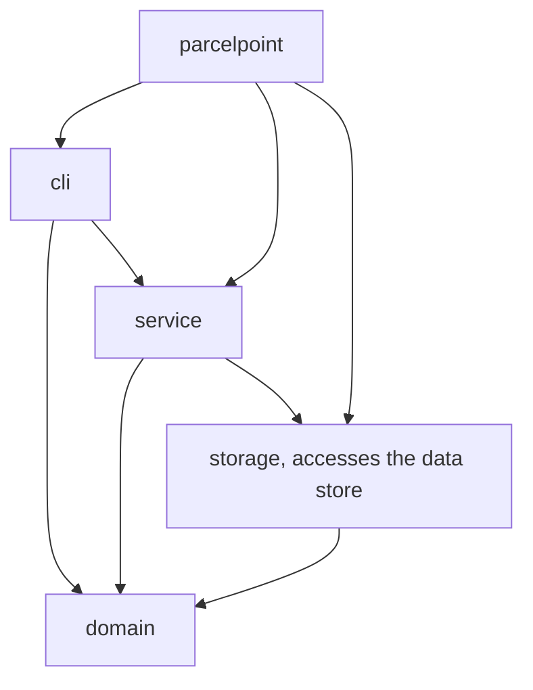
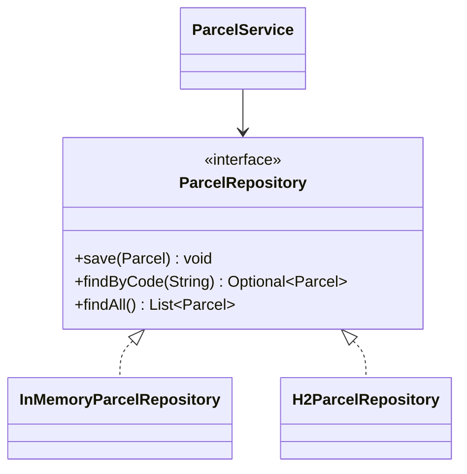
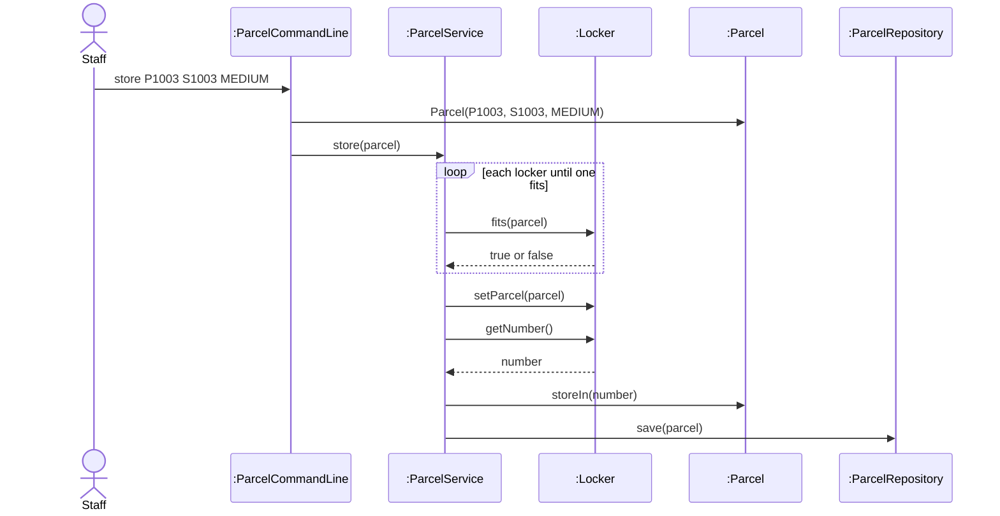

# Lab Report, Designing the Data Management Layer with H2

Repository URL: https://github.com/voodiepipo/itcs382-h2-lab

## Tools

| Item | Version or name |
| --- | --- |
| JDK |	24.0.2 (java -version; Maven Java 27.0.1) |
| Maven | 	3.10.0 |
| IDE | 	Visual Studio Cod|
| AI tool and exact model, if you used one | 	OpenAI Codex, GPT-6|

## Part 0. From a store in memory to H2

Commit of the starter, before any change: 86e7071

0.3 Your prediction for `staff`, written before the second run: 3

Output of the second run, for `staff` and `quit`:

```text
> staff
Free lockers: 3
> quit
```

State in one sentence where you think the parcels of the first run were kept. The parcels were kept in the InMemoryParcelRepository map in the running program's memory, which was cleared when the program ended.

0.5 The line of Main that you would change to keep the parcels somewhere else:

```java
ParcelRepository repository = new InMemoryParcelRepository();
```

0.6 Commit of the switch to H2: 6ff3312

0.7 Output of `SELECT * FROM PARCEL;` after you stored two parcels:

```text
sql> SELECT * FROM PARCEL;
CODE  | STUDENT_ID | PARCEL_SIZE | STATUS | LOCKER_NUMBER
P1001 | S1001      | SMALL       | STORED | 1
P1002 | S1002      | LARGE       | STORED | 3
(2 rows, 25 ms)
sql> 
```

0.8 Explain why ParcelPoint could not start while the H2 Shell was open, and identify the class that wrote the message `ParcelPoint could not start because the H2 Shell was still using and locking the database file, so a second process could not open it. H2ParcelRepository wrote the message Cannot create the PARCEL table when its constructor failed to connect.`.

0.9 Explain why `staff` shows no parcel while `find calls findByCode, which reads a parcel directly from H2. staff calls findAll, which currently returns an empty list, so the ParcelService constructor cannot restore the stored parcels to their lockers. Therefore, all three lockers appear free.` shows each one, and why all three lockers look free.

0.11 Your findAll method:

```java
 @Override
    public List<Parcel> findAll() {
        List<Parcel> parcels = new ArrayList<>();
        String sql = "SELECT * FROM PARCEL ORDER BY CODE";
        try (Connection connection = connect();
             Statement statement = connection.createStatement();
             ResultSet rows = statement.executeQuery(sql)) {
            while (rows.next()) {
                parcels.add(toParcel(rows));
            }
        } catch (SQLException e) {
            throw new IllegalStateException("Cannot read the parcels", e);
        }
        return parcels;
    }
```

Commit that adds findAll: ee84273

0.12 Output of `SELECT * FROM PARCEL;` after the pickup:

```text
sql> SELECT * FROM PARCEL;
CODE  | STUDENT_ID | PARCEL_SIZE | STATUS    | LOCKER_NUMBER
P1001 | S1001      | SMALL       | PICKED_UP | null
P1002 | S1002      | LARGE       | STORED    | 3
(2 rows, 23 ms)
```

0.13 Optional. Describe what `find P9999'OR'1'='1` showed while the SQL was joined from strings, and what it showed after you put the placeholder back.

## Part A. Model the design

A1 Complete the flowchart with one node for each package and one arrow for each dependency, from the package that uses to the package that is used. Mark the package that accesses the data store.



State whether cli depends on storage, and explain why.

A2 Complete the class diagram of the data management layer with ParcelService, the interface ParcelRepository with its three operations, and the two classes that implement it.



A3 Draw a sequence diagram for the command `store P1003 S1003 MEDIUM`, from the staff member to the repository. Show each message as an operation of the class that receives it.



Explain why the last lifeline is the interface ParcelRepository rather than H2ParcelRepository.

## Part B. Design questions
1. I changed `Main.java` to select `H2ParcelRepository` instead of `InMemoryParcelRepository`. I completed `findAll()` in `H2ParcelRepository.java` in a later step. The other classes do not depend on a specific repository implementation; `ParcelService` depends on the `ParcelRepository` interface, following Dependency Inversion.

2. Storing `SMALL`, `MEDIUM` or `LARGE` creates connascence of name because the table values must match the enum names. Storing `1`, `2` or `3` creates connascence of convention because both sides must agree on what each number means. Connascence of name is weaker because the values are more readable.

3. H2 runs inside the application and stores data in a local file, so it does not need a separate server. However, it locks the database file while one process is using it, so ParcelPoint and the H2 Shell cannot open that file at the same time.

4. I would choose H2 because Phase 2 requires persistent data without a separate server. The `storage` package will access the database through repository classes.
## AI usage declaration

| AI tool and exact model | Date | Purpose | Files or answers it produced or changed | How you checked its output |
| --- | --- | --- | --- | --- |
| OpenAI Codex, GPT-6 | 2026-11-14 | Help implement the H2 repository and understand the lab questions | `H2ParcelRepository.java`; suggested answers and diagrams for `LAB_REPORT.md` | Compared the answers with the lab handout, ran `mvn package`, and checked ParcelPoint and H2 Shell output, including the pickup result. |